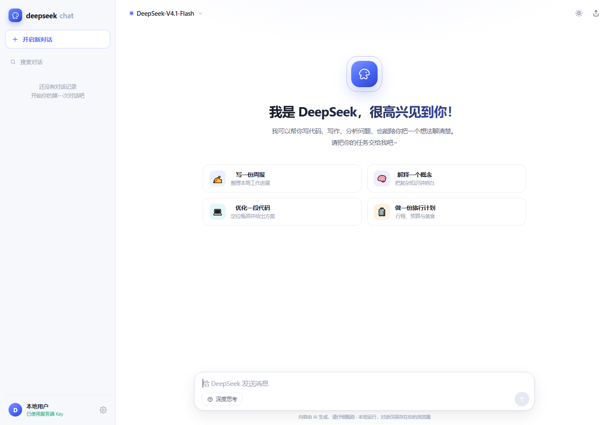

# DeepSeek Chatbox

一个本地运行的 DeepSeek 风格网页聊天框。零依赖 Node 服务 + 原生 HTML/CSS/JS，不需要构建步骤，支持真实 DeepSeek API 流式对话；也可以构建成纯静态版部署到 GitHub Pages。



更多截图：[深色主题](preview-dark.png) · [对话与代码块](preview-light.png) · [移动端](preview-mobile.png)

## 功能

- DeepSeek 风格界面：侧栏会话、欢迎页、模型切换、深浅色主题、响应式布局
- 真实流式输出（SSE），支持停止生成、重新生成、复制、Markdown 导出
- 对话目录（TOC）：列出当前会话的所有提问，点击跳转并高亮；提问和回答分别有独立的 `n/m` 箭头
- 上下文用量：输入框上方显示当前会话的上下文进度条，API 返回 usage 时精确，编辑/新提问时先估算
- 修改提问：编辑任意一条用户提问，旧提问保留在提问栏，并从修改后的提问重新生成回答
- 复制对话：在会话列表点击复制图标，可全部复制，或填写第 m–n 轮只复制指定范围
- 对话 ZIP 备份与恢复：一键导出全部会话，导入时与现有记录合并（同 ID 保留较新版本）
- 深度思考开关：开启后使用更高的推理力度，并展示可折叠的思考过程
- 联网搜索开关：与深度思考并列，开启后模型按需搜索网页并在回答下方列出来源
- 模型：`DeepSeek-V4.1-Flash`（快速）与 `DeepSeek-V4-Pro`（旗舰）
- 默认情况下，会话和 API Key 只保存在浏览器 `localStorage`，可随时清除；也支持用服务端环境变量提供 Key
- 自定义 API 地址，兼容 OpenAI 格式的代理
- 自写轻量 Markdown 渲染（标题、列表、表格、引用、代码块、链接），全部先转义
- 可构建为 GitHub Pages 纯静态版：用户自带 API Key，浏览器直连 DeepSeek，不需要服务器

## 快速开始

要求 Node.js 18.17+。

```powershell
cd deepseek-chatbox
node server.mjs
```

打开 <http://127.0.0.1:3210>。

Windows 也可以双击 `start.cmd`，脚本会自动查找 Node（包括 DSH 自带的运行时）。

## 配置 API Key

任选一种：

1. **在页面里配置（推荐）**：点击左下角「本地用户」→ 填入 API Key → 保存。Key 存在浏览器本地，只通过本机代理转发。
2. **服务端环境变量**：
   ```powershell
   $env:DEEPSEEK_API_KEY = "sk-..."
   node server.mjs
   ```
3. **项目根目录 `.env`**（已加入 `.gitignore`）：
   ```
   DEEPSEEK_API_KEY=sk-...
   ```
   复制 `.env.example` 为 `.env` 即可。

浏览器里填写的 Key 优先使用；没有填写时才回退到服务端环境变量。不要把 `.env` 或真实 Key 提交到仓库。

## 跨设备访问

默认只监听 `127.0.0.1`。要让手机或其他电脑访问，需要让服务监听局域网地址，并且**务必设置访问密码**：

```powershell
$env:HOST = "0.0.0.0"
$env:PORT = "3210"
$env:CHATBOX_USER = "deepseek"          # 可省略，默认就是 deepseek
$env:CHATBOX_PASSWORD = "换成一个足够长的密码"
node server.mjs
```

然后访问 `http://<本机局域网 IP>:3210`。浏览器会弹出 HTTP Basic 登录框，输入上面的用户名和密码；认证成功后 7 天内使用 Cookie 免登录。

注意：

- 不设置 `CHATBOX_PASSWORD` 时没有任何访问保护，局域网内任何人都能用你的服务端 Key 调用 API。
- Windows 防火墙默认可能拦截 3210 端口的入站连接；放行端口需要管理员权限。
- 访问密码只保护入口，不改变 API Key 的权限范围；怀疑泄露时应立即更换密码并轮换 Key。

### 公网临时链接（Cloudflare Quick Tunnel）

公网访问建议让源站只监听本机，再用隧道转发。先另开一个带密码的实例：

```powershell
$env:HOST = "127.0.0.1"
$env:PORT = "3213"
$env:CHATBOX_PASSWORD = "换成一个足够长的密码"
node server.mjs
```

再启动 Cloudflare Tunnel（需先安装 [cloudflared](https://developers.cloudflare.com/cloudflare-one/connections/connect-apps/install-and-setup/installation/)）：

```powershell
cloudflared tunnel --url http://127.0.0.1:3213 --no-autoupdate
```

命令会输出一个 `https://<随机名>.trycloudflare.com` 地址，其他设备可直接打开，登录方式与局域网相同。Quick Tunnel 不需要 Cloudflare 账号，但**没有 uptime 保证，进程重启后 URL 会变化**；长期使用请配置 named tunnel 和自有域名。

> 公网链接等于把受密码保护的 API 代理暴露到互联网。请使用强密码，不要公开分享链接；不再使用时停止 `cloudflared` 和源站进程。

## 纯静态版（GitHub Pages）

如果不想一直开着电脑，可以构建成完全静态的版本，部署到 GitHub Pages。静态版没有 Node 后端，**每位访客必须在页面里填写自己的 DeepSeek API Key**，请求由浏览器直接发往 `https://api.deepseek.com`。

构建：

```powershell
node build-pages.mjs
```

产物在 `dist-pages/`，包含 `index.html`、`app.js`、`config.js`（`mode: "pages"`）、`manifest.webmanifest`、`404.html` 和 `.nojekyll`。

部署到 GitHub Pages：

1. 新建公开仓库，例如 `ds-chat`；
2. 把项目推送到 `main`；
3. 仓库 **Settings → Pages → Build and deployment → Source** 选择 **Deploy from a branch**，Branch 选 `gh-pages`，目录选 `/ (root)`；
4. 之后每次 push 到 `main`，`.github/workflows/pages.yml` 都会重新构建并强制推送 `dist-pages/` 到 `gh-pages` 分支；
5. 地址为 `https://<用户名>.github.io/ds-chat/`。

第一次推送后如果 `gh-pages` 分支还没有出现，等 Actions 跑完一次，或手动执行 `node build-pages.mjs` 后把 `dist-pages/` 发布到 `gh-pages` 分支。GitHub Free 的 Pages 只支持公开仓库。

注意：

- GitHub Pages 只能托管静态文件，**不能隐藏服务端 Key**；静态版不要配置共享 Key。
- 每个访客使用自己的 Key，Key 只存在各自浏览器的 `localStorage`。
- 如果确实需要共享 Key，必须另外部署 Cloudflare Worker、Vercel Functions 或 VPS 代理。
- 构建时会给 `app.js`、`styles.css`、`zip.js` 加内容 hash 查询参数，避免新 HTML 配到浏览器缓存的旧脚本；如果页面本身仍缓存，强制刷新一次即可。
- 构建时可用 `DEEPSEEK_API_BASE` 指定默认 API 地址，访客仍可在设置里覆盖。
- 静态版没有 `/api/chat` 代理、访问密码和服务端日志，这些能力只在本地 Node 版里存在。

## 使用

- `Enter` 发送，`Shift + Enter` 换行；生成中可点击停止
- 输入框上方「深度思考」控制推理力度，「联网搜索」按需检索网页
- 顶部模型菜单切换 Flash / Pro
- 顶栏「对话目录」按提问跳转；用户消息下方「修改」可编辑提问并重新生成
- 右上角按钮切换主题；旁边的「导入 / 导出」菜单可导出全部对话 ZIP、导出当前对话 Markdown，或导入备份
- 设置中可修改 API 地址、默认模型、温度、系统提示词，也可以导入 / 导出对话数据

### 对话目录与轮次版本

- **对话目录**：点击顶栏列表图标，面板会列出当前会话的所有用户提问；点击条目平滑滚动到对应位置并短暂高亮；滚动聊天区时目录会自动标记当前提问。
- **提问箭头**：有多个修改版本时，提问气泡上方显示 `‹ 提问 当前/总数 ›`，用于切换同一轮的不同提问版本；切换提问时会一并显示该提问对应的回答。
- **回答箭头**：有多个重新生成版本时，回答上方显示 `‹ 回答 当前/总数 ›`，只切换同一提问下的不同回答；两套箭头互不混用。
- **修改提问**：悬停（移动端直接显示）用户消息，点击「修改」；编辑后点「保存并重新生成」。原提问会保留在提问栏，原对话不会被删除；每轮最多修改 10 次。
- **重新生成**：每条回答下方都有「重新生成」，不只最后一条；旧回答会自动保留为当前提问的回答版本；每轮最多重新生成 10 次。
- **回答支线**：对话目录面板底部列出当前提问的全部回答版本，包括最初的「原始回答」和重新生成产生的版本，不显示修改提问产生的版本。点击任一支线即可切换。旧版本保留下来的整段分支会自动迁移为对应提问的版本。

### 上下文统计

- 输入框上方会显示当前会话的「上下文」进度条，格式为 `已用 / 上下文窗口` 和百分比。
- 最后一次回答收到 API 的 `usage` 时，使用真实的 `prompt_tokens + completion_tokens`；刚编辑、刚发送新提问或导入旧数据时，先按消息文本估算，发送后用 API 返回值校准。
- 悬停进度条可看到精确 token 数、是否估算以及模型上下文窗口；达到 75% 变橙色，90% 变红色。
- 空闲会话、欢迎页不显示；切换会话或切换版本后会立即按当前会话重新计算。

### 复制对话

- 在左侧会话列表悬停某条对话，点击「复制对话」图标（移动端直接显示）。
- 弹窗会显示该对话共有多少轮，可选择「全部复制」，或填写起始/结束轮次后点击「复制所选轮次」。
- 一轮 = 一条提问及其回答，按当前对话从上到下计数；`m` 和 `n` 由你手动填写，必须满足 `1 ≤ m ≤ n ≤ 总轮数`。
- 复制只会生成新对话并自动切换过去，不会修改原对话；新对话标题会带上「副本」或「第 m-n 轮」。
- 复制的是当前显示的问答内容，不会复制隐藏的历史版本；最多保留 80 个对话。

### 联网搜索

- 输入框上方「联网搜索」按钮与「深度思考」并列。开启后，请求会向 DeepSeek 声明服务端工具 `deepseek_web_search`，由模型判断是否需要搜索，无需客户端执行工具。
- 搜索过程会显示「正在联网搜索…」；回答完成后，回答下方列出本次引用的来源链接。
- 普通模式是联网搜索；同时开启深度思考时，会使用「深度思考搜索」，模型可以多步搜索、打开网页并交叉验证。
- 联网搜索目前需要 `DeepSeek-V4.1-Flash`。开启时会自动切换到 Flash；切到 Pro 会自动关闭该开关。
- 搜索和抓取不额外计费，只计算模型 token；搜索是否发生由模型判断。

### 对话 ZIP 备份

- **导出**：右上角「导入 / 导出」→「导出全部对话（ZIP）」，或设置 →「对话数据」→「导出全部（ZIP）」。
- ZIP 内包含 `manifest.json`、`README.txt` 和 `conversations/*.json`；每个对话是独立、可读的 JSON，保留消息、模型、思考过程和 token 用量。
- **导入**：选择本应用导出的 ZIP（也接受单个 `.json` 文件）。导入会与现有对话合并，不会删除现有记录；相同 ID 的对话保留更新时间较新的版本。
- **兼容 Chatbox 导出**：也支持 Chatbox 的 `chat_sessions/*.json` 格式（`fragments` 里的 REQUEST / RESPONSE / THINK）；附件会以文字标注保留，联网搜索等工具调用会跳过。
- 浏览器本地最多保留 80 个对话；导入时超出上限的记录会被忽略，并在提示中说明。
- 备份可能包含聊天内容，请妥善保管，不要上传到公开位置。

## 预览模式

- `http://127.0.0.1:3210/?demo=1`：注入一段示例对话，便于查看界面
- `http://127.0.0.1:3210/?theme=dark`：强制深色主题

## 环境变量

| 变量 | 默认值 | 说明 |
| --- | --- | --- |
| `DEEPSEEK_API_KEY` | 空 | 服务端 API Key |
| `DEEPSEEK_API_BASE` | `https://api.deepseek.com` | API 地址 |
| `PORT` | `3210` | 端口，被占用时自动 +1 重试 |
| `HOST` | `127.0.0.1` | 监听地址；跨设备访问设为 `0.0.0.0` |
| `CHATBOX_USER` | `deepseek` | HTTP Basic 用户名 |
| `CHATBOX_PASSWORD` | 空 | HTTP Basic 密码；为空时不启用访问保护 |

## 目录

```
deepseek-chatbox/
├─ server.mjs          # 零依赖 HTTP 服务、静态托管、API 流式代理
├─ build-pages.mjs     # 生成 GitHub Pages 纯静态版
├─ .github/
│  └─ workflows/
│     └─ pages.yml     # GitHub Actions 自动部署
├─ public/
│  ├─ index.html       # 页面结构
│  ├─ config.js        # server / pages 模式开关
│  ├─ manifest.webmanifest
│  ├─ styles.css       # 主题与响应式样式
│  ├─ app.js           # 会话、流式渲染、Markdown、设置、对话备份
│  ├─ zip.js           # 零依赖 ZIP 打包/解包
│  └─ favicon.svg
├─ dist-pages/         # 构建产物（已 gitignore）
├─ start.cmd           # Windows 启动脚本
└─ package.json
```

## 说明

- 服务默认只监听 `127.0.0.1`，不会暴露到局域网。
- 上游请求超时 180 秒；浏览器断开时会中止上游连接。
- 对话数据不落服务端磁盘，刷新页面后从浏览器本地恢复。
- 如果使用第三方代理，请在设置里填写完整 Base URL（如 `https://example.com/v1`）。
